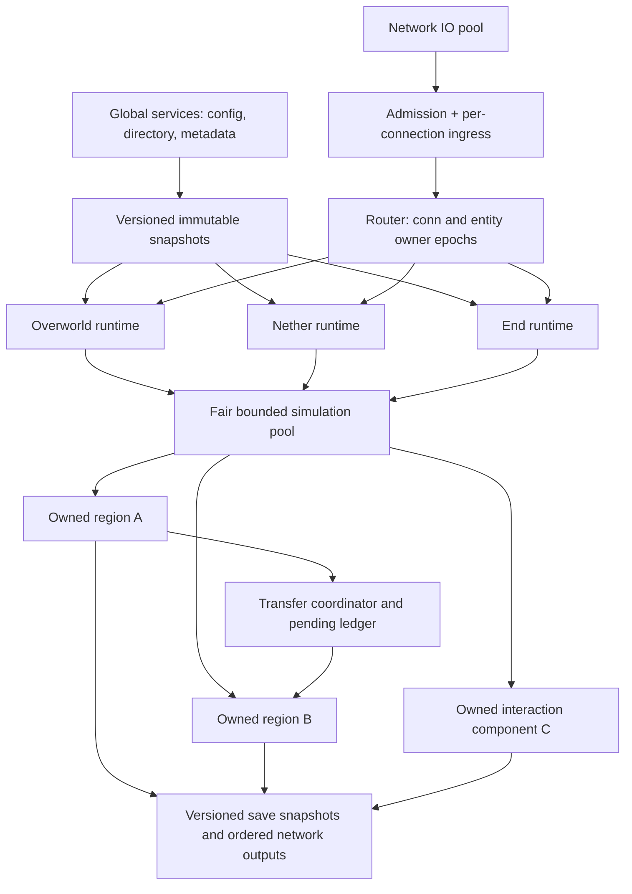

# Horizon: аудит параллелизма и проект миграции

Дата: 2026-11-06. Исследован upstream commit
`1532c9c1530b423ab366792d8a80256914fa909e`.
Все ссылки ниже закреплены на этом commit, а не на движущемся `main`.
**Текущий patch реализует только этап 0: backpressure сетевого ingress.**
Независимые тики измерений, regionizer и перенос владения ниже — проект следующих
этапов, а не уже существующие функции. Численных результатов игрового нагрузочного
теста здесь нет: подготовленных ресурсов Minecraft и Java oracle на этой машине нет.

## 1. Вердикт по исходным утверждениям

| Утверждение | Статус на исследованном commit | Доказательство | Последствие |
|---|---|---|---|
| Сеть и генерация параллельны, основная симуляция последовательна | Подтверждено для исследованного игрового пути | `Game::tick_server`, `Game::tick_world`, `Game::tick_creatures` [S1–S3]; `io_pool`, streaming [S4–S5] | Несколько занятых ядер сами по себе не доказывают масштабирование симуляции |
| Перегруженный Nether задерживает остальные измерения | Подтверждено структурно, размер задержки не измерен | Последовательный цикл `tick_server`; один `wait_for_next_server_tick` [S1] | Даже Overworld, стоящий первым, ждёт Nether перед следующим своим тиком; End ждёт его в текущем |
| Удалённые области одного измерения не тикают параллельно | Подтверждено для текущего уровня | `tick_blocks` обходит чанки; `tick_creatures` обходит мобов [S2–S3] | Удалённые игроки не получают независимый бюджет симуляции |
| Владение препятствует прямому параллельному запуску | Подтверждено | `Parked`, `swap_level`, `enter_level`; `with_level` собирает изменяемый `GameLevel`; `RandomTickSections` содержит `Rc` [S1,S2,S6] | Нельзя безопасно передать несколько `&mut Game` задачам или просто добавить `par_iter_mut` |
| Локальная перегрузка распространяется через общие структуры | Частично подтверждено | Общий последовательный тик; unbounded `Shared.events` и `Lan::poll().try_iter().collect()` [S7]; общий pool генерации и per-dimension writers на общем диске [S5,S8] | Канал может расти до обработки hub; endless drain возможен при непрерывном producer. Реальная стоимость блокировок не профилировалась |
| Никаких ограничений очередей уже нет | Опровергнуто | `Hub::poll`: inbox 8 000 пакетов / 16 MiB, `drain_inbox`: 400 пакетов за проход; `Outbox`: 96 MiB, writer ahead 256 KiB [S4,S9] | Исправлять нужно конкретную очередь до inbox, не заменять уже существующую защиту |
| Single-core оптимизации устраняют предел архитектуры | Опровергнуто как общее утверждение | Один mutable `Game`, последовательные уровни [S1–S3] | Они уменьшают стоимость работы, но не создают независимых владельцев; измеренная последовательная доля пока неизвестна |

На дату проверки открыт [PR #10377](https://github.com/horizon-rust/horizon/pull/10377)
о Rayon для creature ticking; он **не входит** в исследуемый commit. Его заявленные
MSPT и результаты тестов не являются нашими измерениями. Порядок применения outputs
сам по себе не сохраняет parity: текущий следующий моб видит обновлённый snapshot
предыдущего, общие pushes/brain events и RNG. Это конкретные условия для проверки
любого такого PR, а не результат его полного code review.

### Реестр доказательств: файл, символ, код

* [S0: Cargo workspace](https://github.com/horizon-rust/horizon/blob/1532c9c1530b423ab366792d8a80256914fa909e/Cargo.toml),
  [AGENTS.md](https://github.com/horizon-rust/horizon/blob/1532c9c1530b423ab366792d8a80256914fa909e/AGENTS.md),
  [CONTRIBUTING.md](https://github.com/horizon-rust/horizon/blob/1532c9c1530b423ab366792d8a80256914fa909e/CONTRIBUTING.md),
  [архитектурная карта](https://github.com/horizon-rust/horizon/blob/1532c9c1530b423ab366792d8a80256914fa909e/docs/architecture.md).
* [S1: game/levels.rs](https://github.com/horizon-rust/horizon/blob/1532c9c1530b423ab366792d8a80256914fa909e/crates/horizon-client/src/game/levels.rs#L460):
  `Parked`, `Levels`, `Pass`, `swap_level`, `enter_level`, `tick_server`,
  `levels_to_tick`, `wait_for_next_server_tick`, `save_parked_levels`.
* [S2: game.rs](https://github.com/horizon-rust/horizon/blob/1532c9c1530b423ab366792d8a80256914fa909e/crates/horizon-client/src/game.rs#L7845):
  `Game::tick`, `tick_world` (L7938), `tick_blocks` (L5067),
  `with_level` (L4646), `tick_scheduled` (L5349), `impl LevelAccess for GameLevel` (L1216),
  dedicated dispatch (L21775).
* [S3: game/creatures.rs](https://github.com/horizon-rust/horizon/blob/1532c9c1530b423ab366792d8a80256914fa909e/crates/horizon-client/src/game/creatures.rs#L941):
  `Game::tick_creatures`, цикл L1076, `scratch` level RNG, `snapshot[i] = seen(...)`,
  `grid.update` и `apply_brain_events` перед следующей итерацией.
* [S4: lan/io_pool.rs](https://github.com/horizon-rust/horizon/blob/1532c9c1530b423ab366792d8a80256914fa909e/crates/horizon-client/src/lan/io_pool.rs):
  `Session`, `Outbox`, `MAX_PENDING`, `AHEAD`, `pool`, socket polling через mio.
* [S5: streaming.rs](https://github.com/horizon-rust/horizon/blob/1532c9c1530b423ab366792d8a80256914fa909e/crates/horizon-client-render/src/streaming.rs):
  `Shared`, `Queued`, `Mailbox`, `WorkerLocal`, `Streaming`, `save`, `poll_save`.
* [S6: random_tick_sections.rs](https://github.com/horizon-rust/horizon/blob/1532c9c1530b423ab366792d8a80256914fa909e/crates/horizon-client/src/random_tick_sections.rs#L62):
  кэш масок `Rc<RandomTickMask>`.
* [S7: lan/mod.rs](https://github.com/horizon-rust/horizon/blob/1532c9c1530b423ab366792d8a80256914fa909e/crates/horizon-client/src/lan/mod.rs#L353):
  `Shared::events`, `Lan::start_with`, `Lan::poll` (L714).
* [S8: save.rs](https://github.com/horizon-rust/horizon/blob/1532c9c1530b423ab366792d8a80256914fa909e/crates/horizon-client/src/save.rs#L2354):
  `PendingWrites`, `SaveDir`, `Writer`, `RegionCache`, region-file mutexes.
* [S9: lan/hub.rs](https://github.com/horizon-rust/horizon/blob/1532c9c1530b423ab366792d8a80256914fa909e/crates/horizon-client/src/lan/hub.rs#L2020):
  `Hub::poll`, `drain_inbox`, `end_tick`, `PACKETS_PER_TICK`, `INBOX_LIMIT`, `INBOX_BYTES`.
* [S10: game/integrated.rs](https://github.com/horizon-rust/horizon/blob/1532c9c1530b423ab366792d8a80256914fa909e/crates/horizon-client/src/game/integrated.rs#L673):
  `Integrated::call/post`, `Game::run_integrated_inner`, `run_tasks` (L1030).
* [S11: game/dedicated.rs](https://github.com/horizon-rust/horizon/blob/1532c9c1530b423ab366792d8a80256914fa909e/crates/horizon-client/src/game/dedicated.rs#L870):
  `run_dedicated`, `run_dedicated_inner`, вызов `tick_server_spans` (L1320).
* [S12: server/supervisor.rs](https://github.com/horizon-rust/horizon/blob/1532c9c1530b423ab366792d8a80256914fa909e/crates/horizon-server/src/supervisor.rs#L164): `run`;
  [entry.rs](https://github.com/horizon-rust/horizon/blob/1532c9c1530b423ab366792d8a80256914fa909e/crates/horizon-client/src/entry.rs): `main`.
* [S13: level/mod.rs](https://github.com/horizon-rust/horizon/blob/1532c9c1530b423ab366792d8a80256914fa909e/crates/horizon-world/src/level/mod.rs):
  `LevelAccess`, `Behaviours`; [ticks.rs](https://github.com/horizon-rust/horizon/blob/1532c9c1530b423ab366792d8a80256914fa909e/crates/horizon-world/src/level/ticks.rs):
  `Ticks`, `schedule_block/fluid`, `next_sub_tick`;
  [update.rs](https://github.com/horizon-rust/horizon/blob/1532c9c1530b423ab366792d8a80256914fa909e/crates/horizon-world/src/level/update.rs): `NeighborUpdater`, `UPDATE_ORDER`.
* [S14: game/nether_portal.rs](https://github.com/horizon-rust/horizon/blob/1532c9c1530b423ab366792d8a80256914fa909e/crates/horizon-client/src/game/nether_portal.rs#L1162):
  `Arrival`, `land_portal_arrivals`, `resolve_arrivals`, `load/save_portal_arrivals`;
  [server_travel.rs](https://github.com/horizon-rust/horizon/blob/1532c9c1530b423ab366792d8a80256914fa909e/crates/horizon-client/src/game/server_travel.rs): `Trip`, `take_vehicle`, `LevelTeleport`.
* [S15: ordered_tick.rs](https://github.com/horizon-rust/horizon/blob/1532c9c1530b423ab366792d8a80256914fa909e/crates/horizon-client/src/game/ordered_tick.rs):
  `OrderedTicks`, `begin_ordered_ticks`, `run_ordered_ticks`;
  [join_seq.rs](https://github.com/horizon-rust/horizon/blob/1532c9c1530b423ab366792d8a80256914fa909e/crates/horizon-client/src/join_seq.rs): `JoinSeq`, `JoinList`, глобальный `NEXT`.
* [S16: explosion.rs](https://github.com/horizon-rust/horizon/blob/1532c9c1530b423ab366792d8a80256914fa909e/crates/horizon-client/src/game/explosion.rs):
  `ColliderRays`, сбор блоков/сущностей, Java hash order и RNG;
  [lan_actions.rs](https://github.com/horizon-rust/horizon/blob/1532c9c1530b423ab366792d8a80256914fa909e/crates/horizon-client/src/game/lan_actions.rs): `as_guest`, `tick_guests`.
* [S17: dedicated/report.rs](https://github.com/horizon-rust/horizon/blob/1532c9c1530b423ab366792d8a80256914fa909e/crates/horizon-client/src/game/dedicated/report.rs):
  `Recording`, `tick_summary`, `report_levels`, `finish_report`.
* [S18: block_contact.rs](https://github.com/horizon-rust/horizon/blob/1532c9c1530b423ab366792d8a80256914fa909e/crates/horizon-client/src/block_contact.rs):
  TLS `LEVEL`, `in_level`;
  [lan/handoff.rs](https://github.com/horizon-rust/horizon/blob/1532c9c1530b423ab366792d8a80256914fa909e/crates/horizon-client/src/lan/handoff.rs):
  глобальные `OFFERED`, `CHANGED`, ключи чанков без dimension.
* [S19: horizon-threads/src/jobs.rs](https://github.com/horizon-rust/horizon/blob/1532c9c1530b423ab366792d8a80256914fa909e/crates/horizon-threads/src/jobs.rs):
  `Source`, `Rank`, `Class`, `Pool::register`, `choose`, `Registration::drop`,
  `HORIZON_JOB_THREADS`, `default_threads`.

## 2. Карта текущего исполнения

```text
horizon-server::supervisor::run / horizon-client::entry::main
  -> dedicated dispatch -> Game::run_dedicated_inner
     или Integrated создаёт свой Game на "Server thread"
  -> один clock/deadline -> Game::tick_server
  -> levels_to_tick: Overworld, Nether, End
  -> enter_level / swap_level: Parked <-> поля Game
  -> streaming/update_world: результаты фоновых load/generate/light jobs
  -> первый pass: tick (время, погода, функции, autosave, native hooks)
  -> tick_world каждого уровня
     -> tickets -> packets/player actions -> postprocess
     -> scheduled block/fluid ticks -> random ticks -> block events
     -> упорядоченные batches сущностей; mobs с изменяемым snapshot
     -> portal arrivals -> события -> network tracker/block log
     -> late entities, pistons, block entities, sculk
  -> последний pass Hub::end_tick -> общий wait_for_next_server_tick
  -> network pool: framing/compression/encryption/socket write
```

Точный порядок вызовов — [S2], а не универсальная схема Minecraft:
часть изменений блоков удерживается в `block_log_held` до следующей рассылки;
`tick_lan` стоит до поздних block entities. Нельзя перенести всю рассылку в один
условный конец тика без изменения наблюдаемого порядка пакетов.

Мир — `World` с `ChunkMap`, RNG, block entities, POI, журналами изменений.
`Parked` содержит World, Streaming, SaveDir, Ticks, tickets, списки сущностей,
состояния рейдов/sculk/creaking и LAN tracking. `Game` остаётся фактическим владельцем
всех уровней и игроков; `as_guest` временно подменяет и игрока [S1,S16].
Это владение безопасно при последовательном исполнении; оно не является actor API.

Реальная фоновая работа: handshake/configuration threads, bounded play IO pool,
streaming workers, chunk encoding workers (`lan/chunks.rs::ChunkEncoder`), region
writes. Симуляция блоков, AI, коллизии, redstone и применение `LevelEvent` остаются
в игровом потоке. `Ticks` содержит mutable neighbour stack и queues [S13]; это
синхронные зависимости, а не готовые независимые jobs.

Общие mutex/condvar не следует объявлять доказанным CPU bottleneck без профиля:
streaming queue/context/mailbox [S5], region writers [S8], сетевые outboxes [S4],
shared login state [S7], integrated flags/tasks [S10]. `JoinSeq::NEXT` [S15] — общий
relaxed atomic для номеров, не публикация mutable entity state. `run_tasks`
использует ещё один неограниченный drain; этот patch его не исправляет.
TLS block-contact и dimension-less shared handoff [S18] требуют отдельной миграции.

`SaveDir::writer` принадлежит одному каталогу измерения: общего writer mutex всех
измерений аудит не обнаружил. Общими остаются диск, CPU и вызовы snapshot/flush
из последовательного driver. Streaming использует `horizon_threads::jobs::pool`
через `Streaming::new`; это отдельный существующий пул фоновой работы.
У пула уже есть приоритеты Urgent/Near/Far и cap Far jobs, оставляющий место Near.
Но `choose` берёт минимальный Rank, а равенство не заменяет ранее выбранный source:
при постоянно доступных равных ranks ранняя регистрация может вытеснять позднюю.
Это структурная возможность starvation, не измеренный сценарий production [S19].
Существующий pool устраняет размножение фоновых OS-потоков; считать его отсутствующим
или обещать решить это добавлением ещё одного неограниченного пула было бы ошибкой.

## 3. Целевая архитектура: владельцы и исполнение

Новые имена в этой части — **предлагаемые** интерфейсы. Их нет в upstream и в patch.
Начинать следует с извлечения simulation из `Game`, а не с переименования Parked в actor.



### Извлечение состояния

`game/levels.rs::Parked` становится основой `LevelState` (предлагаемый
`game/simulation/level.rs`). Все per-level поля должны переехать вместе, включая
`OrderedTicks`, родившихся/removed сущностей, persist UUID/raw, портальные cooldowns,
RNG/LCG, block logs, native attachments. Перечня Parked недостаточно: он описывает
текущие swap-границы, но shared поля `Game` нужно классифицировать по читателям.
Иначе, например, общий `ticked_entities_through` останется скрытым барьером.

Методы из `game.rs::tick_world/with_level`, `game/creatures.rs`, `ordered_tick.rs`,
`lan_actions.rs` переводятся на `SimulationContext { level: &mut LevelState,
players: &mut PlayerSet, shared: &TickSnapshot, outputs: &mut Outputs }`.
Контекст не содержит `&mut Game`, доступа к renderer или другим уровням.
`LevelAccess` реализует локальный адаптер над этим контекстом.
Компиляционные проверки `Send` применяются к `LevelState` после удаления UI/Rc
из пересылаемого состояния. Кэши `Rc` можно сделать worker-local, а immutable
таблицы — `Arc`; blanket `unsafe impl Send` запрещён.

### Независимые измерения

Сначала один `LevelRuntime` на измерение: эксклюзивное состояние, собственные
tick counter, deadline, input/output queues и admission quotas. Начальная
реализация может держать три долгоживущих OS-потока: это простой способ убрать
взаимное ожидание длинных невытесняемых тиков. После появления регионов состояние
перемещается jobs на ограниченный пул; логический владелец не привязан к thread id.
По умолчанию 20 TPS, но `/tick rate/freeze/step/sprint` получают explicit scope.
Существующие команды без scope адресуются всем измерениям асинхронно и возвращают
результаты каждого; согласованный global step — специальная административная
операция с явным барьером, не обычный tick loop.

Глобальный сервис публикует immutable версии gamerules, scoreboard/team views,
registry, weather/daylight. Уровень фиксирует версию на входе тика. Нет требования
«каждый уровень закончил epoch N, прежде чем любой начинает N+1». Изменения
scoreboard сериализуются global owner; команда с read-after-write ждёт конкретный
request id. Межмировые функции и плагины, требующие синхронный `&mut Game`, идут в
совместимый serial mode либо должны перейти на async receipts. Статический hook
с TLS dimension оборачивается на каждом job, но TLS не служит владением.

Время разделяется на simulation/redstone time уровня/региона и опубликованное
calendar time. При перегрузке simulation замедляется локально; daylight может
следовать global clock. Это намеренное отличие от текущего общего game time,
которое должно быть описано игрокам и проверено для AI timers. Погода сейчас
потребляет RNG активного мира: её нельзя просто читать из другого потока. Сначала
явно извлечь owner/RNG и зафиксировать изменение random stream в regional mode.

CPU всё ещё общий: ограничить фоновые generation/encode jobs; reserve хотя бы один
worker для прочих ready dimensions при C>=2; лимит concurrent jobs на dimension;
weighted deficit accounting по фактически затраченному CPU, а не числу jobs.
Нет свободного CPU — нет обещания 20 TPS. На одном ядре независимая задержка не
гарантируется. Память/I/O: per-dimension quota на loaded chunks, generation permits,
snapshot bytes и writer credits плюс global ceiling. При заполнении producer
откладывает загрузку/сохранение, не блокирует simulation worker на file I/O.

### Данные и память

| Данные | Владелец | Читатели | Изменение | Синхронизация | Срок жизни |
|---|---|---|---|---|---|
| Registry, Behaviours, recipes | resource service | все runtime | заменить Arc-версию при reload | публикация snapshot, ack старых readers | до освобождения последней версии |
| Chunk sections, BEs, POI, dirty/logs | RegionState | только его executor; внешние immutable snapshots | локальные методы LevelAccess | exclusive job lease | до unload/merge |
| Mobs/vehicles/items, UUID/raw NBT, passengers | регион или transfer ledger | локальный тик и published views | только owner; move whole bundle | epoch + transfer receipt | spawn → destroy/save |
| Ticks, neighbour stack, RNG/LCG, ordered ticks | регион/component | его executor | локально в точном порядке | та же lease | переносится при split/merge |
| Player gameplay state | регион игрока | network читает packets/views | input commands у owner | conn epoch + FIFO | login → durable logout |
| Conn codec/socket/outbox | IO worker | routing metadata | IO worker | текущий Outbox lock | connection lifetime |
| Calendar/config/scoreboard/directory | global owners | versioned readers | serialized typed commands | bounded mailbox; snapshots | server lifetime |
| Persistence bytes | save worker | storage | immutable owned snapshot с revision | credits, completion receipt | до durable ack |
| In-flight transfer | coordinator ledger | source/destination по receipt | конечный автомат, один authoritative payload | serialized coordinator | до commit/abort + ack horizon |

Без собственных lock-free структур: safe Rust, `Box<RegionState>` перемещается
между ready/worker/completion. Никаких raw pointers в entity handles. Идентификатор
региона `(slot, generation)`, сущности `(UUID, generation)`; wire u32 остаётся
сетевым отображением и не является долговечным адресом. При исчерпании generation
slot выводится из обращения; wrapping reuse запрещён.

Мелкие atomic counters соседних регионов могут давать false sharing: хранить
счётчики у owner и публиковать раз в quantum; padding вводить после измерения.
Не клонировать `Arc` на каждый collision query: один snapshot guard на job.
Scratch vectors/command buffers переиспользовать у worker, ограничивать retained
capacity. Snapshot sections используют существующий COW, но snapshots не должны
бессрочно удерживать старые chunks; ограничить их версии/bytes.

## 4. Причины, изменения, инварианты и проверка

| Причина | Изменение и места | Инвариант | Проверка | Остаток |
|---|---|---|---|---|
| Один Game и loop измерений | LevelState/SimulationContext; levels.rs, tick_world, integrated/dedicated loops, lan_actions | Нет shared mutable поля между runtime | Nether overload, owner access assertions, thread sanitizer где доступен | CPU/I/O общие |
| Один World/списки/Ticks | RegionState и region views; World/ChunkMap adapter, Ticks, entity/ordered_tick, creatures | Chunk/entity имеет одного владельца | distant regions, unique-owner model, compatibility harnesses | Связный hotspot остаётся serial |
| Синхронные соседние вызовы | conservative connected ownership + quiescent merges; LevelAccess, level/update.rs, explosion.rs | Нет чтения живого чужого state и записи без lease | boundary redstone/fluid/blast traces | Область зависимостей может стать всем измерением |
| Entity/portal transfers опираются на порядок уровней | transfer ledger; nether_portal.rs, server_travel.rs, persist.rs, tracking | Один authoritative payload, один ticking owner | retarget/cancel/drop/restart tests | Async placement меняет межмировой порядок |
| Неограниченный ingress до inbox | Реализованный lan/ingress.rs + PlayConn/Lan/report | Packet credits не превышены, consumer pass конечен | overload/drop/concurrency/Lan integration tests | Служебные сообщения и другие очереди ещё требуют quotas |
| Общие clocks/hooks/saving | versioned global services; functions/commands/mods/save | Нельзя вызвать старый synchronous world API из чужого job | scoped command receipts, save/shutdown scenarios | Legacy моды требуют serial mode |

## 5. Региональные протоколы и инварианты

### Regionizer

Единица хранения — chunk column. Для spatial index использовать section из 8x8
чанков (проектный параметр, не disk region 32x32). Регион — connected component
активных section и buffer ownership, а не фиксированная квадратная клетка.
Один scheduler job владеет всем RegionState; одновременные jobs одного региона
невозможны конструктивно: ready queue отдаёт сам `Box`, не копируемый handle.

Регион содержит entity lists, ChunkMap subset, Ticks/LCG, BE order, portals,
персистентные attachments, dirty journals, local clock и input/output sequencers.
Пустой halo нужен для ограниченных локальных операций, но фиксированное число
чанков не является доказательством безопасности произвольного AI или взрыва.
Для каждого subsystem требуется declared access domain. Незнакомый native hook
или произвольная команда без такого domain исполняется через exclusive component
operation либо serial level; нельзя молча разрешить чтение всего World.

Создание/расширение region только в quiescent точке. Running region не растёт.
Соседние активные halos не тикают одновременно; regionizer запрашивает объединение.
Split: нет running job, transfer ownership fence завершён, соседняя активность
отсутствует, очереди разделены по target chunk, clocks копируются. Merge: оба
quiescent, забраны из ready queue, new generation, пересобраны indexes/BE order,
все данные перемещены, старые адреса forwarding tombstones до ack outstanding requests.
Deadlines scheduled ticks переводятся через **remaining delay**, а не напрямую
копируются между различными local clocks. Priority и stable ordering сохраняются.
Sub-tick counter при merge перенумеровывается стабильным total order, без коллизий.

Hysteresis: merge по обязательной зависимости сразу, split после 100 локальных
тиков без связности и не чаще одного раза за 5 s (предлагаемые стартовые значения).
Рёбра недавних взаимодействий удерживать на этот интервал; проверять по monotonic
wall time, чтобы lag не делал cooldown бесконечным. Hotspot нельзя разбивать по
номерам сущностей: контактный граф/пассажиры/цепь redstone объединяют компоненту.
Ускорение такой компоненты ограничено её последовательными зависимостями.

### Границы: механизм и видимость

| Категория | Протокол | Видимость/совместимость |
|---|---|---|
| Движение/коллизии/атака | До изменения владеть swept AABB и collision/query halo; взаимодействующие тела в одном компоненте. Preflight расширяет/объединяет domain до первого эффекта | Контакт и урон применяются в текущей операции, не через слепую очередь «на следующий тик». Произвольная скорость/телепорт не покрывается фиксированным halo |
| AI/цели/pathfinding | Immutable snapshot годится для advisory поиска далёких кандидатов. Перед атакой, pickup, LOS-dependent действием — owner validation либо совместная lease. Локальный AI сохраняет последовательное обновление seen grid [S3] | Snapshot может изменить выбор/задержку реакции. Для strict parity все влияющие queries выполняются в общей компоненте; stale snapshot не объявляется эквивалентным vanilla |
| Redstone/block updates/pistons | Вся синхронная цепь под одной interaction lease; сохранить NeighborUpdater stack, порядок направлений и `MAX_CHAINED_NEIGHBOR_UPDATES`. Conservative scope — весь loaded connected component, неизвестный hook — весь уровень до первого эффекта | Не добавлять искусственный tick delay, не сортировать изменения только по координате. Неизвестные cross-domain hooks требуют serial fallback |
| Жидкости/scheduled ticks | Local Ticks; trigger tick, priority, sub-order; synchronous updates той же lease. При split/merge перенос контейнеров по chunk с rebasing remaining delays | Межрегиональные часы могут различаться; абсолютное game-time vanilla между независимыми регионами не сохраняется |
| Взрывы/fill/clone | Preflight conservative footprint, включая rays, entity exposure, chained TNT, drops и neighbour updates; quiesce components и выполнить одну операцию в прежнем локальном порядке | Не применять половину взрыва по произвольному приходу commands. Если полный domain не доказан до первого эффекта — whole-level lease |
| Chunk load/unload | Worker возвращает owned result с `(dim,chunk,generation,request,revision)`. Region принимает только актуальный request; load hooks/BE/entity joins у owner. Unload после snapshot и отсутствии leases/transfers/tickets | Результат старого generation отбрасывается; save ack относится к конкретной revision. Загрузка не мутирует живой World из worker |
| Телепорт/портал | Transfer state machine ниже; поиск/строительство выхода отдельно; passengers/root vehicle — один bundle | Cross-dimension arrival async; текущий порядок «ранний уровень → поздний уровень» [S14] сохранить при независимых clocks нельзя |
| Multi-region команды | Parser прежний. Typed plan получает request id, scope, target leases; read-only может fan-out snapshots с указанием версий. `execute store`, clone и read-modify-write требуют coordinated lease | Ответ после apply acknowledgements. All-or-nothing только если запрошен и получен общий fenced scope; `execute in` больше не вызывает swap_level |

Пограничные действия не должны «частично выполнить и потом повторить всё»:
это дублирует RNG draws, drops и hooks. Для операций с неизвестным domain необходимо
сначала рефакторить глубоко рекурсивные `Behaviours/Sim` вызовы в resumable steps.
Continuation сохраняет neighbour stack, текущую операцию, RNG state, event cursor
и уже применённый progress, но выполняется только внутри заранее захваченного scope.
Не подменять незахваченный блок воздухом: нынешний `LevelAccess::block_state` не
выражает ошибку владения, поэтому regional adapter нельзя включать до добавления
проверяемого access-domain протокола. До этого компонент целиком тикает serial.
Нельзя объединить уже частично выполненные A:write(x),read(y) и B:write(y),read(x)
и назвать результат последовательным: обе могут увидеть новые значения. Выбранный
протокол **не разрешает NeedsDomain после первого write/RNG draw/observable hook**.
При неизвестном domain operation получает whole-level lease заранее. Для встроенных
локальных chains scope включает весь загруженный connected component, а новые
chunk activations откладываются до его safe point. Поэтому произвольная дальняя
команда или native hook уменьшает параллелизм, а не исполняется небезопасно.

`AwaitDomain` существует только в read-only preflight, до mutable operation:
worker возвращает Box coordinator, нет захваченного чужого borrow или опубликованных
effects. Coordinator забирает все затронутые quiescent states, объединяет scope
и запускает полную операцию один раз. Остальные preflights отменяются/перепланируются
по новым generations; их reads не имели эффектов. Если preflight зависел от snapshot
block values, после получения
leases проверяются все read revisions; при расхождении план строится заново до
первого эффекта. Независимый от block values conservative domain такой проверки
для границ не требует, но результаты read-modify-write всё равно валидируются.
Топология не меняется посреди
mutable continuation. Yield такой continuation сохраняет её полную lease и не
разрешает тики участников до завершения; worker освобождается, но component
связан логически. На bounded CPU pool это не hold-and-wait другой lease.
Transactional staging с rollback могло бы ослабить conservative scope, но оно
не входит в выбранный проект и не является скрытой предпосылкой корректности.

### Перенос сущности

Адрес: `OwnerAddr { dimension, region_slot, region_generation, entity_generation }`.
TransferId уникален в session и на диске (session UUID + monotonic counter).
Coordinator хранит directory и authoritative pending payload. Сеть хранит conn epoch
отдельно: старый пакет игрока не становится командой новому incarnation.

```text
Active(source, epoch e)
  -> Preparing(t): destination capacity/chunk ticket reserved; source still owner
  -> Frozen(t,e): source ends current entity operation, removes from tick lists
  -> Pending(t,e+1): payload moved into coordinator ledger; source tombstone
  -> Installed(t,e+1): destination holds inactive payload, sends Prepared receipt
  -> Committed(t,e+1): directory points to destination; activation receipt queued
  -> Active(destination,e+1): next eligible destination entity phase; ACK
  -> Retired(t): source/destination receipts complete, journal compactable
```

Frozen выполняется между **полными** entity operations, не в середине движения
или native callback. Source после Frozen не тикает entity и passenger subtree.
Destination после Installed не тикает её до Commit. До source удаления должны
быть reserved control/transfer slots: заполненная очередь не теряет payload.
Coordinator передаёт payload посредством owned Rust values, не делает два active
clone. Inactive installed copy допустима только как serialization/staging, а не
вторая запись в active entity lists. Её unique TransferId отличает replay.

Сообщения в пути: owner-independent envelope `(UUID,generation,request,source_seq)`
маршрутизируется coordinator; Pending держит bounded inbox. FIFO одного sender
сохраняется, разные senders получают receipt order. При full — Busy/retry с тем же
id; damage/transfer нельзя тихо drop/coalesce. Target operation dedup по request id
и producer ack watermark; tombstone удаляется лишь после завершения outstanding
sequence диапазона. Stale epoch получает Redirect/Retired, не выполняется у старого
владельца. Старые conn packets после teleport fence валидируются через protocol
teleport acknowledgement; не переигрывать движение из предыдущего мира.

`last_completed_entity_step` и activation fence исключают replay уже завершённого
source step. Нет общего server tick между независимыми clocks: гарантия — один
owner и однократность конкретного entity step, а не одинаковое число тиков за
настенные 50 ms во всех измерениях. Для coordinated component один logical tick
token; перенос внутри него сохраняет last-step token и не даёт double tick.

Ошибки до Pending: reservation освобождается, entity остаётся source. После
Pending только coordinator решает Abort/Commit. Timeout — запрос состояния t,
а не разрешение source восстановить копию. Abort до commit возвращает payload
source с новым epoch и только после отмены inactive destination. После commit
откат — отдельный transfer. Если destination остановлен/не загрузился, entity
остаётся durable Pending либо возвращается source; не пропадает по timeout.

Атомарная наблюдаемая граница — изменение directory из Pending в Committed у
coordinator, плюс отсутствие ticking owner в Pending. Это не одновременная
доставка всех spawn/despawn packets клиентам и не атомарность файлов разных миров.
Crash durability требует journal: Frozen/Pending intent durable до сохранения
source без entity; destination snapshot содержит transfer id, затем durable Commit.
Recovery читает journal и версии snapshot, активирует ровно одну копию; сырой NBT
без transfer id для crash recovery недостаточен. Graceful shutdown может обойтись
ledger drain и одним согласованным snapshot, но не обещает crash atomicity.

Shutdown: запретить новые transfer/admission; остановить новые ticks; завершить
текущие leases; resolve/cancel pending portals; materialize каждый Pending в одном
месте (неизвестный выход — source); durable save этих owner + playerdata; flush
writers; закрыть network; join pools. Любая ошибка записи возвращается как ошибка
shutdown, ledger не удаляется. Unload/split ждут только затрагивающий их transfer,
не все миграции сервера. Использовать существующие arrivals NBT и SaveDir, но
добавить версионированный transfer journal; нынешний `horizon_portal_arrivals.dat`
[S14] не является таким transaction log.

### Scheduler, cooperative budgets и очереди

| Вариант | Что подходит | Что не обеспечивает сам по себе |
|---|---|---|
| Три std threads | Первый dimension этап, простое exclusive владение, OS preemption между уровнями | Region balance/fairness при сотнях регионов; shared CPU/I/O quota |
| Существующий `horizon_threads::jobs::Pool` | Готовые источники работ, shared CPU helpers, worker-local caches, Urgent/Near/Far | Нет dimension deficit/deadlines, tie-breaking не защищает от starvation, drop Registration ждёт jobs; не вызывать его из своего job |
| Rayon explicit ThreadPool | Чистые bounded CPU kernels, work stealing/locality | Per-dimension deadlines/quotas; join создаёт барьер вызывающего; TLS должен задаваться на job |
| Tokio tasks | Router, timers и async IO | CPU функция до yield блокирует executor; spawn_blocking не заменяет контролируемый simulation pool |
| Собственный небольшой scheduler поверх std | Per-dimension deficit + earliest eligible deadline, move-only leases, bounded ready slots | Сам требует tests; невытесняемый Rust callback не ограничивается wall budget |

Источники API: S19, [Rayon ThreadPool](https://docs.rs/rayon/latest/rayon/struct.ThreadPool.html),
[Tokio task](https://docs.rs/tokio/latest/tokio/task/index.html).
Выбор проекта: std pool и serialized coordinator, без lock-free work-stealing
первой версии. Locality — предпочтение предыдущего worker при равном deadline;
steal только whole region job, не заимствованный mutable substate. Размеры пулов
в сумме ограничить CPU budget, а не запускать generation и simulation каждый по C.

Ready означает: deadline наступил; есть resident RegionState; нет running lease,
topology fence или неподтверждённого transfer, затрагивающего операцию. Coordinator
сам владеет ready heap/lease table; каждый регион может иметь один queued job.
Completion возвращает Box и новую eligible deadline. Отставание не создаёт тысячи
catch-up jobs: максимум один pending tick; debt учитывается как lag, не память.

Fairness: сначала выбрать dimension с наименьшим normalized consumed CPU deficit,
затем earliest eligible region deadline с age boost. Каждый постоянно ready
dimension получает минимум один quantum за round при конечных quantum. Просроченный
hotspot получает дополнительный debit, а не бесконечный приоритет. Одно long-running
operation всё же удерживает worker: это явно отражается в tail latency.

Предлагаемый quantum 2 ms и максимум 64 entity operations / 256 resumable update
steps (стартовые цели, не измеренный optimum). Yield между сущностями сохраняет
phase, join cursor, snapshot/grid, pending pushes, RNG, outputs и command cursor;
между chunk random ticks — chunk/section/position cursor и LCG; neighbour chains —
явный NeighborUpdater continuation. Недописанная цепь не публикуется как полный
tick. Arbitrary callback, большой worldgen kernel или explosion function не
вытесняются безопасно: сначала вводится continuation, либо операция остаётся
indivisible и время не гарантируется. Рабочий поток не ждёт другой worker/IO,
он возвращает `AwaitDomain/AwaitIO` coordinator и освобождает слот.

Для будущих mailbox: 4 096 envelopes / 8 MiB payload на регион, 64 MiB на dimension,
256 MiB global (проектные лимиты, настраиваются после memory benchmark); transfer
control имеет отдельные pre-reserved slots. Порядок `(sender_epoch,sequence)`,
commit receipt определяет межsender order. Position views coalesce по entity id;
gameplay actions/урон/дропы не coalesce. Fill/взрыв передаёт bounded batch plan,
не миллионы отдельных envelopes. Full возвращает ownership команды producer с
RetryAfter/Busy; producer ограничивает собственную pending очередь. Повторная
попытка сохраняет id; конфликт версии — Replan/Conflict. Shutdown закрывает
admission, drains admitted requests, отвечает Cancelled на остальные.

Deadlock предотвращается запретом hold-and-wait mutex/worker leases: coordinator
собирает scope в отсортированном порядке либо откладывает **весь** scope; domain
expansion разрешён только read-only preflight. Mutable continuation сохраняет
уже полный scope и не запрашивает ещё одну lease. Worker не ждёт с mutex или
заимствованным RegionState другого job.
Livelock повторных merge избегать sticky dependency edge и bounded backoff;
starvation ready jobs — age boost и admission limits. Прогресс условен: конечные
callbacks/critical sections, weak fairness OS и исполнителей. `std::Mutex` сам
не гарантирует fairness или starvation-freedom; hard bound latency без этого
не обещается. Структуры blocking, не lock-free и не hard real-time. На процесс crash
прогресс не обещается; сохранность — только через durable journal.

## 6. Реализованный patch и проверки

Изменены:

* `crates/horizon-client/src/lan/ingress.rs`: EventSender/EventReceiver,
  per-player/global packet/byte accounting, RAII Charge, ограниченный drain, stats.
* `lan/mod.rs`: настоящий канал `Shared.events` переведён на этот интерфейс,
  `Lan::poll` использует bounded batch.
* `lan/conn.rs::PlayConn::packet`: Full превращается в disconnect packet-rate,
  Disconnected закрывает соединение как раньше. Network worker не ждёт consumer.
* `game/dedicated/report.rs::finish_report`: JSON `network_ingress` со snapshot
  gauges, lifetime high-water marks и количеством отклонённых пакетов.

Начальные лимиты (константы patch, **не результаты измерений**): 32 768 queued play
packets и 64 MiB распакованных body bytes глобально, 8 000 / 16 MiB на connection;
4 096 events за poll. Hub inbox limits остаются дополнительным следующим рубежом.
`Charge` удерживается до detach batch, освобождается также при failed send и drop
receiver. Detached batch может содержать ещё до 4 096 packets помимо новой queued
квоты; body bytes не равны wire bytes или decoded heap, общего RSS ceiling patch не гарантирует.
Служебный поток Joined/Left/Duplicate не ограничен packet quota: это сохраняет
lifecycle FIFO и не теряет Left при flood. Отдельное bounded lifecycle admission
и per-dimension ingress fairness — следующий этап, не скрытая гарантия этого patch.

`Shared.events` теперь имеет тип `EventSender`, не `std::mpsc::Sender<NetEvent>`.
Вызовы `.send` и `.clone` сохраняются, но explicit type annotations стороннего
native code требуют адаптации; это не обещание ABI совместимости. `NetEvent`
и wire packets не меняются. Save format этим patch не затрагивается.

Новая синхронизация: один короткий `Mutex<Budget>` для admission/release/statistics.
Нет gameplay/сетевого I/O под mutex; guard освобождается до mpsc send. Mutex unlock
happens-before последующий lock, mpsc публикует owned Queued consumer. Новых atomic,
CAS, `unsafe`, ABA/reclamation алгоритмов нет. Квота не доказывает fairness mutex;
shared contention необходимо измерить. Poison reserve отклоняет admission, release
восстанавливает guard для освобождения существующих reservations.

Тесты исполняют production queue: flood одного игрока/credit другого, byte/global
limits, zero-byte packet count ceiling, несколько concurrent producers с FIFO и
exactly-once delivery, receiver drop/failed send, actual `Lan::start_with/poll`.
Это проверка очереди, не доказательство entity ownership/region protocol: последних
ещё нет в реализации. Фактические команды и результаты записаны в
[concurrency-validation.md](concurrency-validation.md).

## 7. Миграция, приёмка, откат и измерения

| Этап | Изменение | Gate приёмки | Откат |
|---|---|---|---|
| 0 (этот patch) | Network ingress admission + finite drain + report gauges | Queue invariants; client build; LAN regression; memory/latency benchmark перед релизом | Revert patch, данные на диске не менялись |
| 1 | LevelState и SimulationContext; пока прежний последовательный driver | Все прежние parity traces идентичны; нет потерянных Parked fields; единый game tick API без renderer | Старый driver за feature gate, format unchanged |
| 2 | Dimension runtimes, scoped commands, transfer ledger, network router | Nether isolation; portals/shutdown/recovery; documented clock/arrival semantics | Gate выключен; drain transfers и canonical save перед serial restart |
| 3 | Regionizer с одним worker, domain checks и quiescent topology | Все split/merge/ownership tests, redstone/fluid/explosion traces внутри component | Объединить region states, rebasing clocks и canonical save |
| 4 | Fair multi-worker scheduler, resumable kernels, bounded mailboxes | Distant-region scaling и lag isolation; invariant counters нулевые | Один worker не возвращает vanilla semantics автоматически; для полного отката canonical save + serial mode |
| 5 | Locality tuning, parallel pure kernels, native regional API | Профили и repeatable performance benefit без parity regressions в заявленном scope | По отдельным feature flags |

Каждый этап — отдельный небольшой PR. Не включать экспериментальный regional mode
по умолчанию до gates. В этом patch нет фиктивного флага, который якобы включает
ещё не реализованный runtime. Публикация в fork не означает готовность релиза.

### Обязательные сценарии

Все пороги ниже — **целевые критерии приёмки**, не измеренные результаты.
Фиксировать seed, save snapshot, input replay, build profile, C физических ядер,
CPU frequency/SMT, RAM/OS, view/simulation distance, число entities и background jobs.
Baseline — исследованный SHA; очередь patch сравнивать отдельно от следующих фаз.
По 3 повтора, 120 s прогрев + не менее 600 s записи; для p99.9 нужны десятки тысяч
samples, доверительный интервал и число samples, не один удачный скриншот.

| Сценарий | Проверка и целевой gate |
|---|---|
| Nether перегружен, Overworld лёгкий | При C>=2 и reserve свободного CPU: Overworld TPS>=19.5, p99 tick-start lag не более baseline+5 ms; Nether lag может расти. Global command, I/O и transfer ожидание считать отдельно |
| Удалённые active regions одного уровня | 2/4/8 независимых clusters: одновременно заняты >=2 simulation cores; p95 service time/throughput улучшаются с C до saturation, без обязательного lockstep finish |
| Один hotspot | Все контактные entities одного component, нет double tick/loss; отчёт показывает serial floor и никакого обещания линейного ускорения |
| Boundary/portal churn | 100 000 transfers с forced interleavings, duplicate receipts, stale epochs, retarget/cancel; сумма Active+Pending+Installed authoritative entities сохраняется, active owner count<=1, шаг не применяется дважды |
| Redstone/fluids/explosions на границах | Сдвинуть ту же fixture относительно section boundary; сравнить block/event/RNG order с single-component исполнением; никаких дополнительных tick delays внутри synchronous chain |
| Split/merge в активности | Повторять topology changes на yield points; conservation chunks/entities/ticks, remaining schedule delay и BE order; нет split running region |
| Full queues/slow consumer | Очереди не превышают заявленные caps с учётом detached batches; Full не блокирует IO worker; disconnect/Left доставлен после accepted packets; no silent gameplay drops; gauges/peaks/rejections проверяются |
| Save/unload/shutdown при migration | Остановка в каждом state автомата, ошибках writer, затем reopen/recovery: UUID существует ровно один раз, generation корректен, перенос не replay; неизвестный portal exit возвращается source |

Метрики: отдельно dimension/region `service_ms` (MSPT), tick-start lag, interval/TPS,
queue wait, p50/p95/p99/p99.9, mailbox packet+byte depth/peak/reject, owner violations,
duplicate step/request counts, pending transfers, loaded/snapshot bytes, RSS peak,
simulation CPU vs generation/IO CPU, mutex wait и merge/coordinator time. MSPT не
заменяет tick-start lag: быстро выполненный тик может долго ждать очередь.
Текущие level spans [S1,S17] включают shared first-pass работу; их нельзя считать
уже готовой независимой метрикой MSPT уровня. Новый ingress report содержит lifetime
peaks/rejections с момента Lan start, не только recording window.

Пускать workload на 1,2,4,... физических ядрах с одинаковой нагрузкой; `HORIZON_WORKER_THREADS`
меняет число helpers, но не pinning процесса к физическим cores. Отдельно ограничить
affinity/cgroup/cpuset средствами OS и записать mapping SMT. Считать speedup по
throughput или completion time одного finite replay, а не по capped 20 TPS.
Оценить `s=(C/S(C)-1)/(C-1)` для Amdahl и показать goodness-of-fit: overhead, memory
bandwidth и меняющаяся связность нарушают простую модель. Предел `1/s` — оценка
для этого workload, не универсальная характеристика Rust или Horizon.

Для текущего общего pool фиксировать и `HORIZON_JOB_THREADS`: он непосредственно
задаёт число jobs workers; `HORIZON_WORKER_THREADS` используется default policy
и рядом других helpers. При исследовании fairness воспроизводить длительный
источник Urgent и два равных Near, измерять wait time каждого source.

Использовать существующие `tick_order`, `mob_ai`, `redstone`, `block_update`,
`random_tick`, `piston_movement`, `block_entity_tickers`, `server_dimension_players`,
`save_roundtrip`, `world_reopen`, `server_entities` harnesses, LAN e2e `portals/levels/blast`.
Пример реального dimension harness:
[test_server_dimension_players_parity.py](https://github.com/horizon-rust/horizon/blob/1532c9c1530b423ab366792d8a80256914fa909e/tools/test_server_dimension_players_parity.py).
Дополнить transfer state-machine tests через exhaustive deterministic event permutations;
при введении собственных атомиков — Loom модель до включения, для `unsafe` (если
оно вообще понадобится) отдельный safety contract + Miri на подходящих unit tests.

## 8. Совместимость и нерешённые вопросы

**Strict/legacy mode** сохраняет один последовательный уровень/общий driver,
vanilla RNG order и межмировой порядок. **Regional mode** обещает локальные
синхронные операции в порядке существующих kernels, но не общую vanilla-equivalence
между независимыми clocks и компонентами. Нет способа одновременно сохранить
один order-sensitive level RNG, текущую total order всех entities, разные скорости
регионов и полностью независимое их исполнение.

Поэтому regional mode использует точную отличающуюся политику: persistent RNG и
LCG на fixed section 8x8 chunks, координаты через `div_euclid(8)`, а не на dynamic
region/thread. Seed LegacyRandom — первые 8 байтов SHA-256, big endian signed i64,
от конкатенации `(stream_version:u32 BE, world_seed:i64 BE, dim_utf8_len:u32 BE,
dim_utf8, section_x:i32 BE, section_z:i32 BE)`. Начальный LCG — младшие 32 бита
этого seed. Версия 1 закрепляет эту формулу; state обоих генераторов сохраняется.
Это **новая** семантика, не vanilla random sequence.

У каждой операции один origin section: стартовая позиция entity, инициирующий
block tick, source position взрыва; multi-source команда выбирает lexicographic
minimum target section, а операция без spatial origin — dimension control stream
с отдельным domain tag в seed. Operation/continuation сохраняет origin stream id
и точный продвинутый state; не пересеивается при merge или переносе continuation.
Split раздаёт fixed-section streams по owner, merge сохраняет их map без смешивания.
Одна незавершённая операция блокирует новые операции на своём stream до resume.
Entity после завершения transfer использует section назначения на следующем шаге;
RNG самого mob переносится с ним. Выход портала генерируется destination operation
на destination stream. Новые fixed sections создают свой stream по той же формуле.
Это делает policy независимой от split/merge истории, но не от порядка операций.
LCG random-tick positions также изменяются относительно vanilla level-wide LCG.

Альтернатива — serial RNG/event
ordering owner, который возвращает архитектурную связанность; не выдавать её за
независимость. Внутри connected component сохранять order, а глобальные отличия
проверять как утверждённый compatibility contract. Scheduled tick ordering между
разными clocks не имеет прежнего total order. Для равных due ticks в компоненте
сохранять priority/sub-order и documented tie-breakers при merge.

Fixed schedule + записанные inputs/RNG streams могут давать воспроизводимость
одной версии на одной платформе. Детерминизм между разными scheduling schedules
и платформами из этого не следует (float math, arrival timing, independent RNG).
Wire protocol сохраняется, packet order одного conn сохраняется; latency и
межрегиональный порядок изменяются. Region clocks/RNG/transfer journal требуют
versioned companion metadata; canonical Anvil/entity NBT сохранять через SaveDir.
Перед откатом материализовать Pending entities и local schedules, иначе простое
удаление companion file теряет состояние. Native моды со synchronous global world
access нельзя считать автоматически совместимыми: owner-aware API и explicit
capabilities либо serial fallback обязательны.

Folia используется как первичный источник **архитектурных компромиссов**, без
копирования её исходников: [region invariants](https://docs.papermc.io/folia/reference/region-logic/),
[independent clocks, teleports, shutdown](https://docs.papermc.io/folia/reference/overview/).
Применимы exclusive chunk ownership, quiescent merge/split, local deadlines и
перенос remaining delays. Это не доказательство vanilla-equivalence Horizon:
Horizon имеет Game swaps, собственный level RNG, typed entity batches и native hooks.
Folia описывает async teleport и специальные shutdown rules, а также отличие
поведения portal creation. Ни эти изменения, ни её scheduler нельзя переносить
механически. Лицензионное ограничение CONTRIBUTING соблюдается: изучена публичная
документация, исходники Folia не адаптировались.

Остаётся реализовать всё после этапа 0, включая isolation per dimension, region
state/domain extraction, scheduler, transfer journal, native API и нагрузочные
измерения. Patch не устраняет общий sequential tick и не заявляется production-ready.
Язык Rust обеспечивает проверку части владения; выигрыш от алгоритмов, локальности,
других data structures и нового scheduling нужно измерять отдельно. Отсутствие
JVM/GC само по себе не обосновывает обещания скорости.
